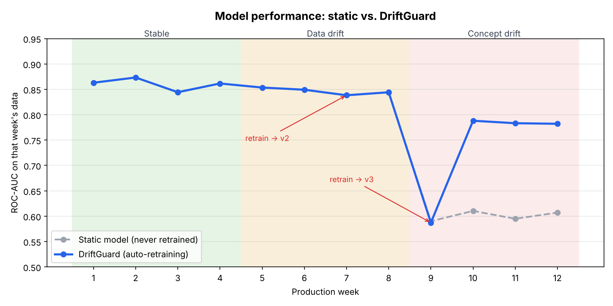

# DriftGuard – Model Drift Detection & Automated Retraining Pipeline

**MLOps Research Project (AIM4142)** · Garima Mathur · 23FE10CAI00243

A machine-learning model that predicts loan default is deployed and then
watched for 12 simulated production weeks. DriftGuard detects when the world
changes, raises an alert, retrains the model automatically, validates the new
model against the old one, and promotes it only if it is better.

## Results at a glance

| Metric | Static model (no MLOps) | DriftGuard |
| --- | --- | --- |
| Mean ROC-AUC over 12 weeks | 0.769 | **0.814** |
| ROC-AUC in final week | 0.607 | **0.782** |
| False alarms in stable weeks | – | **0** |
| Data drift detected | – | week 7 (PSI) |
| Concept drift detected | – | week 9 (AUC drop) |



## How it works

```
 new weekly batch ──► production model scores it ──► drift detector
                                                    │  PSI + KS test per feature
                                                    │  AUC vs baseline
                                                    ▼
                                         drift?  ── no ──► log "OK"
                                                    │ yes
                                                    ▼
                         alert ──► retrain on last 2 weeks ──► validate vs production
                                                                   │
                                          better ──► promote in registry, update reference
                                          worse  ──► reject, keep current model
```

| File | Purpose |
| --- | --- |
| `src/config.py` | All thresholds and settings |
| `src/data_generator.py` | Synthetic loan data with stable / data-drift / concept-drift phases |
| `src/drift_detector.py` | PSI, Kolmogorov-Smirnov test, performance-drift check |
| `src/train.py` | Model (StandardScaler + Gradient Boosting) and evaluation |
| `src/registry.py` | File-based model registry (versions, production / archived / rejected) |
| `src/pipeline.py` | Orchestrates monitoring, alerting, retraining and promotion |
| `src/visualize.py` | Charts and console screenshots |
| `src/predict.py` | Score a new applicant with the production model |
| `tests/test_drift.py` | 11 unit tests |
| `.github/workflows/ml-pipeline.yml` | CI/CD: tests + pipeline + quality gate on every push and weekly |
| `Dockerfile` | Containerised run |

## Run it

```bash
pip install -r requirements.txt
python -m unittest -v          # run the tests
python -m src.pipeline         # run the 12-week monitoring simulation
python -m src.visualize        # create charts in reports/figures/
python -m src.predict --age 35 --income 60000 --loan_amount 20000 \
  --credit_score 700 --debt_to_income 0.25 --employment_years 5 --num_credit_lines 4
```

With Docker: `docker build -t driftguard . && docker run driftguard`

## Outputs

- `reports/monitoring_log.csv` – one row per week: metrics, PSI per feature, action taken
- `reports/drift_reports.json` – full drift report per week
- `reports/alerts.log` – alerts and retraining decisions
- `reports/summary.json` – headline results and the model registry
- `models/registry.json` – every model version with metrics and status
- `reports/figures/` – charts and screenshots
